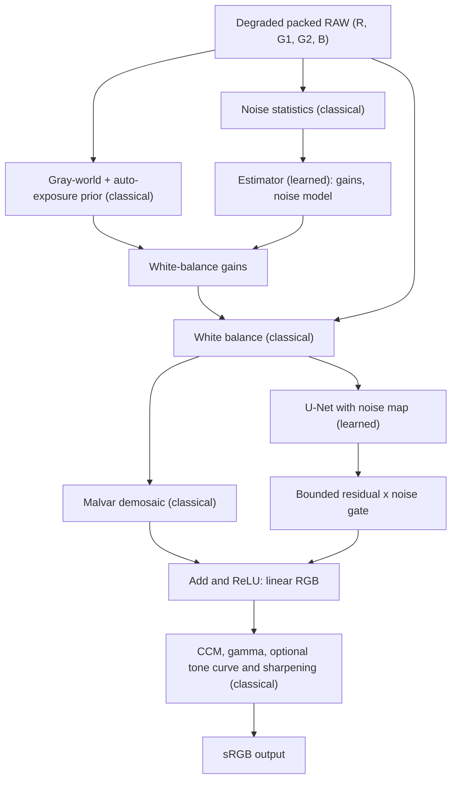

# Design Document: AdaptISP, an Intelligent and Computationally Efficient Smartphone ISP

**Problem statement:** P2 (Intelligent and Computationally Efficient Smartphone ISP)
**Team:** T07
**USNs:** 1RUA24CSE0303, 1RUA24CSE0312, 1RUA24CSE0277, 1RUA24CSE0314, 1RUA24CSE0317
**Repository:** https://github.com/Pranoi123/CV_hackathon
**Live application:** TO BE ADDED (permanent public URL)

---

## 1. Problem statement and objectives

Build a smartphone-style Image Signal Processing (ISP) pipeline that turns degraded sensor data into a high-quality RGB image while balancing colour accuracy, noise reduction, sharpness and computational cost. The solution must be a **hybrid**: classical ISP stages combined with learned components, compared against a purely classical ISP and a purely learned ISP.

Objectives:

1. Implement the classical stages (demosaicing, white balance, colour correction, denoising, gamma/tone mapping, sharpening, colour-space transforms).
2. Implement a learned RAW-to-RGB component and train it on a suitable dataset.
3. Integrate both in a hybrid pipeline that adapts to noise and illumination.
4. Reduce model cost (size, latency, memory) and measure it.
5. Compare traditional, learned and hybrid ISPs with PSNR, SSIM, Delta E 2000 and LPIPS.

## 2. Requirement coverage

| Requirement | How it is addressed | Where |
|---|---|---|
| Bayer RAW preprocessing and demosaicing | RGGB packing into 4 channels; Malvar-He-Cutler demosaic | `isp_core.py`: `pack_rggb`, `demosaic_malvar` |
| White balance | Gray-world gains with auto-exposure as a prior, refined by a learned estimator | `oracle_gains`, `Estimator` |
| Colour correction matrix | Fixed 3x3 matrix (generic camera-to-sRGB) | `CCM_DEFAULT`, `render_tail` |
| Denoising / edge-preserving filtering | Guided filter in the classical baseline; learned residual U-Net in the hybrid | `guided_filter`, `UNet` |
| Gamma, tone mapping, sharpening, colour spaces | sRGB gamma; optional S-curve and unsharp mask; Lab conversion used in the loss and Delta E | `render_tail`, `rgb2lab_torch` |
| Learned ISP architecture | U-Net-based RAW-to-RGB models (hybrid residual U-Net and an end-to-end learned baseline) | `UNet`, `HybridISP`, `LearnedISP` |
| Training on a dataset | Trained on simulated RAW derived from SIDD sRGB images | `train_eval.py`, `isp_data.py` |
| Robustness to noise and illumination | Degradation simulator (noise, illuminant, exposure) and sweeps over each factor | `degrade`, `train_eval.py` |
| Hybrid architecture and comparison | Traditional vs learned vs hybrid on identical inputs | `train_eval.py`, `isp_eval.py` |
| Adaptive pipeline | Learned estimator predicts gains and noise model; noise map conditions the U-Net; noise-dependent gate scales the residual | `HybridISP.forward` |
| Model optimisation | Small student network, depthwise-separable convolutions, knowledge distillation, ONNX export and INT8 post-training quantisation, FP16 | `train_eval.py`, `isp_eval.py` |
| Size, memory, latency | Parameter count, weight size, MACs, CPU latency, peak memory | `isp_eval.py` |

## 3. Data

- **Source:** SIDD (Smartphone Image Denoising Dataset) clean sRGB images, extracted by `prep_sidd.py` into `sidd_gt/` (160 images across 10 scenes).
- **Simulated RAW:** each sRGB image is converted to a clean packed RAW by inverse sRGB gamma, inverse colour correction matrix and RGGB Bayer mosaicing. This is simulated RAW, not real sensor RAW.
- **Split:** scene-level, so no scene appears in more than one split (images / scenes): train 120 / 7, validation 19 / 1, test 21 / 2.
- **Augmentation:** random crops (96 x 96 packed, i.e. 192 x 192 pixels) and Bayer-safe flips (a flipped mosaic is re-aligned so the RGGB layout is preserved).
- **Degradation simulator (`degrade`)**, applied on the fly to the clean RAW:
  - illuminant colour cast from a colour temperature T in 2500 to 8000 K (red gain exp(0.8x), blue gain exp(-0.9x), x = (5500 - T) / 5500);
  - exposure shift of -1.5 to +0.75 stops, with sensor clipping;
  - heteroscedastic noise with variance a x signal + b (Gaussian approximation of Poisson-Gaussian), with the shot-noise gain a sampled log-uniformly between 1e-4 and 1.5e-2.
- **Target image:** the Malvar demosaic of the clean RAW with identity white balance, then CCM and sRGB gamma, so the original sRGB image is recovered.
- **Real-noise check:** real NOISY and GT sRGB pairs from SIDD are converted to simulated RAW with the same procedure (real noise after the camera ISP, not real RAW noise).

## 4. System architecture

The full diagrams (inference pipeline, baselines, data and loss flow, repository workflow) are in [`architecture.md`](architecture.md). Summary of the hybrid pipeline (`HybridISP.forward`):



### 4.1 Classical stages

| Stage | Method |
|---|---|
| Packing | RGGB mosaic to 4 channels at half resolution |
| Noise statistics | Difference of the two green planes divided by sqrt 2, MAD-clipped, 4 brightness bins, giving an 8-value feature vector and a global noise sigma |
| White balance and exposure | Gray-world gains scaled so the mean level is 0.18 (prior) |
| Demosaicing | Malvar-He-Cutler 5x5 filters |
| Denoising (classical baseline) | Guided filter, radius 2, strength from the measured noise |
| Colour correction | Fixed 3x3 matrix |
| Tone | sRGB gamma; optional S-shaped tone curve |
| Sharpening | Optional unsharp mask |

### 4.2 Learned components

- **Estimator:** a 32 x 32 thumbnail of the RAW passes through three stride-2 convolutions (16, 32, 32 channels) and global pooling; the result is combined with the 8 noise features and the log mean brightness, then an MLP (64 hidden units) outputs 5 values: residual log-gains for R, G, B and the noise model parameters log a and log b (noise variance a x signal + b). Gains are the prior times exp of the residual.
- **Noise map:** per-channel noise standard deviation sqrt(a x raw + b), scaled by the gains, concatenated with the white-balanced RAW to give an 8-channel U-Net input.
- **U-Net:** two downsampling and two upsampling levels (transposed convolutions), skip connections, blocks of two 3x3 convolutions with ReLU (optionally depthwise-separable), 12-channel output followed by PixelShuffle x2.
- **Residual and gate:** the U-Net output is bounded as 0.5 x tanh(output), multiplied by a noise gate tanh(150 x sigma) (sigma is the global noise estimate), and added to the classical demosaic. The gate reduces the learned correction on very clean inputs.

### 4.3 Baselines

- **Traditional ISP:** gray-world white balance with auto-exposure, Malvar demosaic, guided-filter denoise, CCM, gamma.
- **Learned only:** a single U-Net (base width 32) mapping the 4-channel RAW to RGB with PixelShuffle, with no classical stages.

## 5. Design decisions and rationale

| Decision | Rationale |
|---|---|
| Keep demosaic, white-balance prior, CCM and gamma classical | Cheap, interpretable and physically meaningful; the network only has to learn a correction |
| Network predicts a residual on top of Malvar demosaic | Starts from a reasonable image (head is zero-initialised) and stabilises training; the bounded output prevents over-saturation |
| Learned estimator refines classical gains | Corrects failures of gray-world assumptions with an inexpensive thumbnail network |
| Noise map and noise gate | Let a single network adapt its correction to the measured noise level |
| Small student with depthwise-separable convolutions and distillation | Lower parameters, weight size and latency than the end-to-end baseline |
| Scene-level split | Prevents leakage between train and test from near-duplicate images of the same scene |
| Differentiable classical stages | Allow the whole pipeline to be trained end to end |

## 6. Training

Implemented in `train_eval.py`.

| Item | Setting |
|---|---|
| Models | Teacher: `HybridISP` base 32; Student: `HybridISP` base 12 with depthwise-separable convolutions; Learned baseline: `LearnedISP` base 32 |
| Optimiser | AdamW, learning rate 2e-3, weight decay 1e-4, cosine-annealed |
| Batch / crop | Batch size 8, packed crop 96 x 96 |
| Gradient clipping | Norm 1.0 |
| Noise curriculum | First 30 percent of steps use shot-noise gain a in [1e-4, 3e-3], then [1e-4, 1.5e-2] |
| Loss | L1 + 0.4 x (1 - SSIM) + 0.02 x Lab-space L1 (colour-accuracy proxy) + 0.1 x estimator supervision (L1 on log gains, 0.5 x L1 on each of log a and log b) |
| Estimator labels | Log of the gains that undo the simulated colour cast and exposure change, and the true noise parameters |
| Distillation | The student adds 0.5 x L1 between its output and the teacher's output |
| Model selection | Best validation PSNR on 24 fixed validation crops (a fixed degradation seed) |
| Step counts | Set with `--teacher-steps`, `--student-steps`, `--learned-steps` |

## 7. Optimisation

| Technique | Detail |
|---|---|
| Compact architecture | Student with depthwise-separable convolutions: 47,597 parameters, 0.21 MB weights, against 651,692 parameters and 2.61 MB for the learned baseline |
| Knowledge distillation | A larger hybrid teacher guides the student (Section 6) |
| ONNX export and INT8 quantisation | The U-Net core is exported to ONNX and statically quantised (QDQ) with ONNX Runtime using 32 calibration inputs |
| FP16 | Half-precision benchmark with autocast when a GPU is available |

Parameters, weight size, MACs, CPU latency (512 x 512 and 1080p inputs) and peak memory are measured by `train_eval.py` and reported in [`eval_P2_T07.md`](../eval_P2_T07.md), together with the INT8 versus FP32 quality comparison.

## 8. Evaluation protocol

- Identical noisy inputs for every method, with fixed test crops and fixed degradation seeds.
- Test set: 48 crops (128 x 128 packed) drawn from the held-out test scenes, under random noise, illuminant and exposure conditions.
- Metrics: PSNR, SSIM, Delta E 2000, LPIPS (AlexNet); parameters, weight size, MACs, latency, peak memory.
- Robustness sweeps over noise level, illuminant temperature and exposure, plotted as curves (`robustness_curves.png`).
- Real-noise check on SIDD NOISY/GT sRGB pairs converted to simulated RAW.
- Methods compared: traditional ISP, learned-only ISP, hybrid teacher, hybrid student.
- Results: [`eval_P2_T07.md`](../eval_P2_T07.md).

## 9. Application and deployment

`app.py` is a Gradio application. It accepts a RAW file (.dng, .nef, .arw, .cr2 and similar, read with `rawpy`) or a JPG/PNG image (converted to simulated RAW), up to 80 MB. Inputs larger than 512 pixels on the longest packed side are 2x2 Bayer-binned for speed. Users can simulate degradation with sliders (noise level, colour temperature, exposure) and apply a manual warmth edit and tone contrast. The interface shows four images: the degraded RAW with a naive demosaic, the learned white balance and demosaic stage, the traditional ISP output, and the hybrid ISP output, together with the estimated gains, the estimated noise level and the CPU latency. Errors (no file, oversized file, unreadable file, unsupported sensor pattern, missing checkpoint) are reported as messages.

Reproduction:

```
pip install -r requirements.txt
python prep_sidd.py                      # extract clean sRGB from SIDD Small into sidd_gt/
python train_eval.py --img-dir sidd_gt   # training, evaluation, benchmarks, report
python app.py                            # Gradio demo at http://localhost:7860
```

## 10. Future work

Evaluate on real RAW; use camera-specific colour matrices and lens shading correction; deploy the INT8 model on a mobile device; add expert-retouched targets for stylistic tone mapping.

## 11. References

1. A. Abdelhamed, S. Lin, M. S. Brown. A High-Quality Denoising Dataset for Smartphone Cameras (SIDD). CVPR 2018.
2. H. S. Malvar, L.-W. He, R. Cutler. High-quality linear interpolation for demosaicing of Bayer-patterned color images. ICASSP 2004.
3. K. He, J. Sun, X. Tang. Guided image filtering. IEEE TPAMI 2013.
4. O. Ronneberger, P. Fischer, T. Brox. U-Net: convolutional networks for biomedical image segmentation. MICCAI 2015.
5. A. Ignatov, L. Van Gool, R. Timofte. Replacing mobile camera ISP with a single deep learning model (PyNET). CVPRW 2020.
6. R. Zhang et al. The unreasonable effectiveness of deep features as a perceptual metric (LPIPS). CVPR 2018.
7. G. Hinton, O. Vinyals, J. Dean. Distilling the knowledge in a neural network. 2015.
